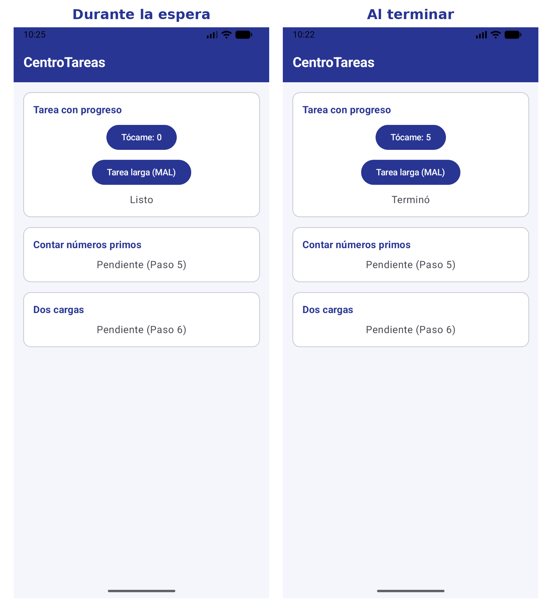
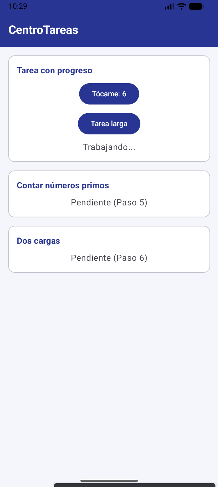
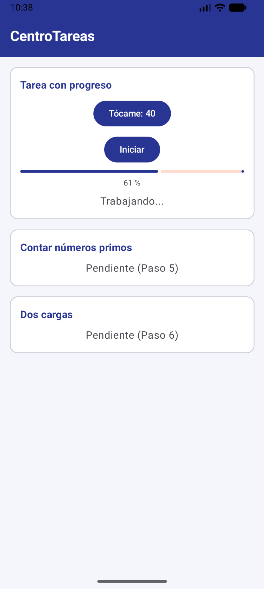
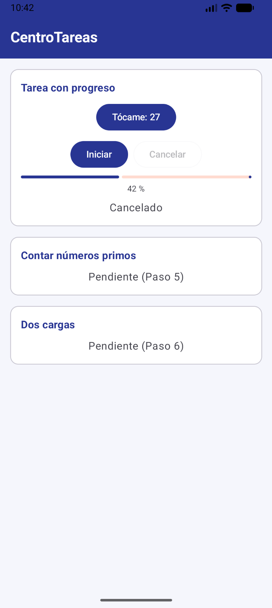
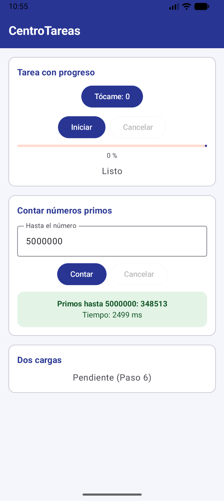
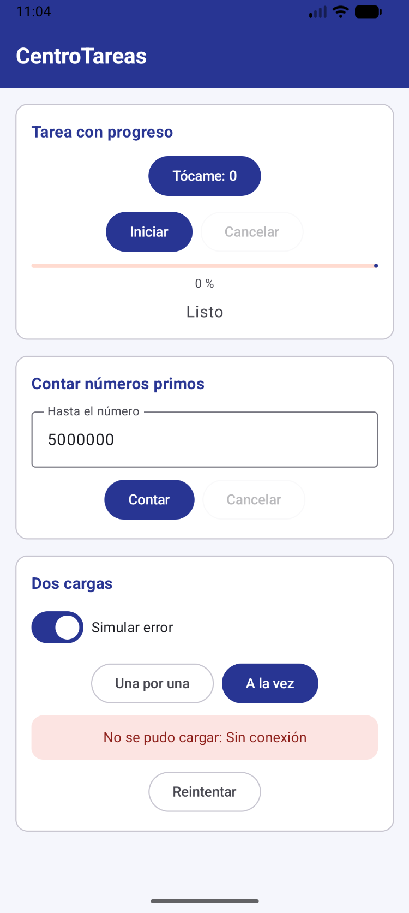
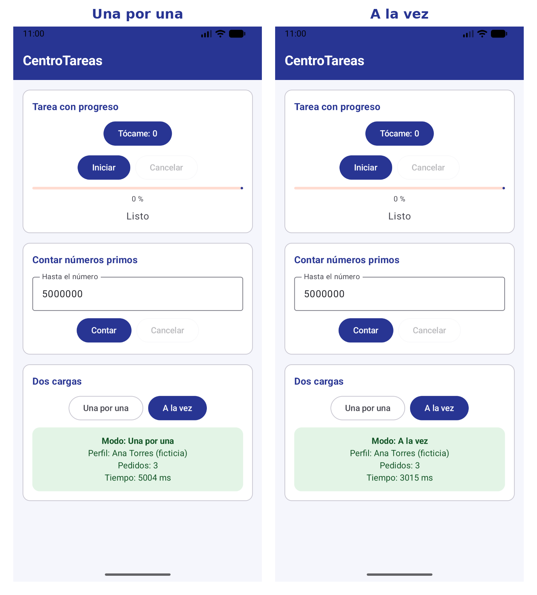
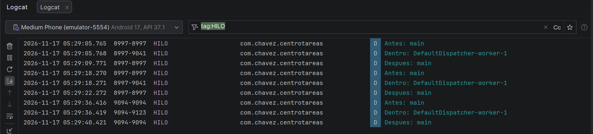

# CentroTareas

**Que la pantalla nunca se congele.**

App Android que hace tres tareas que tardan —una tarea con barra de progreso, un cálculo pesado (contar números primos) y dos cargas de datos simuladas— **sin bloquear nunca el hilo principal**. Primero muestra el problema (la pantalla congelada con `Thread.sleep`) y después lo resuelve con **corrutinas**: segundo plano con `withContext`, progreso con `StateFlow`, cancelación con `Job`, trabajo en paralelo con `async` y manejo de errores con reintento.

| Dato | Detalle |
|---|---|
| Alumno | Farid Chávez Campos |
| Curso | Programación en Móviles — TECSUP |
| Docente | Juan León S. |
| Laboratorio | N.° 14 — Hilos en Android |
| Tecnología | Kotlin + Jetpack Compose + Material 3 (sin XML), corrutinas y `ViewModel` |
| Patrón | MVVM + Repository (interface) |
| Datos | Ficticios: perfil «Ana Torres (ficticia)» y pedidos 101, 102 y 103 |

---

## Tecnologías

```kotlin
implementation("androidx.lifecycle:lifecycle-viewmodel-compose:2.8.7")
```

- Las corrutinas (`launch`, `async`, `withContext`) y `viewModelScope` vienen con Compose y `ViewModel`.
- Sin permisos ni internet: las cargas se simulan con `delay`.
- Tema propio de Material 3 con paleta **índigo + coral** (sin color dinámico ni los colores por defecto).

---

## Estructura de paquetes

```
com.chavez.centrotareas/
├── MainActivity.kt                    Punto de entrada: crea el ViewModel con la factory
├── model/
│   └── Estados.kt                     PrimosUi y CargaUi (estados de cada tarjeta)
├── data/
│   ├── TareasRepository.kt            interface: contarPrimos, cargarPerfil, cargarPedidos
│   └── TareasRepositoryLocal.kt       cargas simuladas con delay y contarPrimos en Dispatchers.Default
├── viewmodel/
│   ├── TareasViewModel.kt             corrutinas, progreso, Job, async y manejo de errores
│   └── TareasViewModelFactory.kt      crea el ViewModel con su repositorio
└── ui/
    ├── PantallaTareas.kt              las tres tarjetas (solo muestra estados y avisa eventos)
    └── theme/                         Color.kt, Theme.kt, Type.kt
```

---

## Arquitectura MVVM + Repository

```
View (PantallaTareas)
   │  eventos: botones, interruptor           ▲  collectAsState()
   ▼                                           │
ViewModel (TareasViewModel)  ───── StateFlow ──┘
   │  viewModelScope.launch { ... }
   ▼
TareasRepository (interface)  ───►  TareasRepositoryLocal
                                    (cargas simuladas y contar primos)
```

| Capa | Conoce a | No hace |
|---|---|---|
| **View** (`ui/`) | Solo a su ViewModel | No lanza corrutinas ni usa `Thread`; solo muestra el estado y avisa los eventos |
| **ViewModel** | Solo a la interface del Repository | No conoce Composables, no recibe `Context` y no bloquea el hilo principal |
| **Repository** | Nada de la UI | No expone estados de pantalla; sus funciones `suspend` no bloquean el hilo desde el que se llaman |

En el código final **no hay** `GlobalScope`, `runBlocking` ni `Thread.sleep`, y toda `CancellationException` atrapada se vuelve a lanzar.

---

## Observación del Paso 1

**¿Qué pasa con la pantalla?**
Al pulsar **Tarea larga (MAL)** la app se congela durante unos 4 segundos: el botón **Tócame** no suma, los botones no reaccionan y nada se redibuja. Cuando termina la espera, los toques que hice mientras estaba congelada se procesan de golpe y el texto pasa directamente de **Listo** a **Terminó**.

**¿Por qué no se ve "Trabajando..."?**
`tareaLargaMala()` se ejecuta en el **hilo principal**, que es el mismo que dibuja la pantalla y atiende los toques. El código cambia el mensaje a "Trabajando...", pero la pantalla no se redibuja hasta que el hilo principal queda libre. Como `Thread.sleep(4000)` lo bloquea 4 segundos y justo después el mensaje cambia a "Terminó", cuando Compose por fin puede dibujar el `StateFlow` ya tiene el último valor ("Terminó"). "Trabajando..." nunca llega a pintarse.

**¿Qué mostraría Android si la espera fuera de 10 segundos?**
Mostraría el diálogo **ANR** (*Application Not Responding*, "La app no responde"), con las opciones **Esperar** o **Cerrar app**. Android lo muestra cuando el hilo principal no responde a un evento del usuario (como un toque) en unos **5 segundos**. Con 10 segundos bloqueado, cualquier toque superaría ese límite.

---

## Capturas

**1. Pantalla congelada (Paso 1):** durante los 4 segundos la pantalla sigue en «Listo» y los toques no se ven; al terminar, los 5 toques se procesan de golpe y el mensaje pasa directo a «Terminó».



| 2. La pantalla responde (Paso 2) | 3. Tarea con progreso | 4. Tarea cancelada |
|:---:|:---:|:---:|
|  |  |  |

| 5. Contar primos | 6. Error simulado |
|:---:|:---:|
|  |  |

**7. Una por una (5004 ms) contra a la vez (3015 ms):**



**8. Logcat (filtro `HILO`):** la corrutina empieza en `main`, el trabajo corre en `DefaultDispatcher-worker-1` y vuelve a `main`, unos 4 s después.



---

## Resultados obtenidos

| Prueba | Resultado |
|---|---|
| Primos hasta 100 / 1000 / 10 000 | 25 / 168 / 1229 |
| Primos hasta 500 000 | 41 538 en ≈ 200 ms |
| Primos hasta 5 000 000 (valor por defecto) | 348 513 en ≈ 2500 ms |
| Una por una | ≈ 5004 ms |
| A la vez | ≈ 3015 ms |

**Ajuste del valor por defecto:** con 500 000 el cálculo tardaba unos 200 ms en mi emulador, demasiado rápido para notar que la pantalla no se congela ni para alcanzar a cancelar. Como indica el laboratorio, subí el valor por defecto a **5 000 000**, que tarda entre 2 y 5 segundos.

---

## Pruebas de aceptación

| # | Prueba | Resultado esperado | OK |
|---|---|---|:---:|
| 1 | Tarea larga: tocar **Tócame** mientras trabaja | El contador sigue sumando | ✅ |
| 2 | Logcat con filtro `HILO` | `main` antes y después; `DefaultDispatcher-worker` dentro | ✅ |
| 3 | Iniciar la tarea con progreso | La barra avanza de 0 a 100 % en ≈ 4 s | ✅ |
| 4 | Cancelar a mitad | La barra se detiene, dice **Cancelado** y se puede iniciar otra vez | ✅ |
| 5 | Pulsar **Iniciar** dos veces seguidas | No se lanzan dos tareas (el botón está deshabilitado) | ✅ |
| 6 | Primos hasta 1000 | Resultado **168** | ✅ |
| 7 | Primos con N grande | La pantalla no se congela y **Cancelar** funciona | ✅ |
| 8 | Una por una | ≈ 5 s y resultado correcto | ✅ |
| 9 | A la vez | ≈ 3 s y resultado correcto | ✅ |
| 10 | Error simulado + **Reintentar** | Recuadro rojo; al desactivar el interruptor y reintentar, éxito | ✅ |
| 11 | Rotar la pantalla durante la tarea | La tarea continúa y el progreso no se reinicia | ✅ |
| 12 | Revisar el código | `git grep` no encuentra `GlobalScope`, `runBlocking` ni `Thread.sleep` | ✅ |

---

## Problemas que encontré y cómo los resolví

| Problema | Causa | Solución |
|---|---|---|
| El cálculo de primos con 500 000 terminaba casi al instante (≈ 200 ms) | El emulador es rápido para ese tamaño | Subí el valor por defecto a 5 000 000 (≈ 2,5 s) |
| Después de cambiar el valor por defecto, el campo seguía mostrando el número anterior | `rememberSaveable` conservó el valor guardado al aplicar los cambios sin reiniciar la app | Detener la app y volver a ejecutarla para que arranque desde cero |
| Riesgo de que un error "falso" apareciera al cancelar una carga | `CancellationException` es un tipo de `Exception`, así que un `catch (e: Exception)` también la atraparía | Atrapar primero la `CancellationException` y relanzarla con `throw e`, y después los errores reales |
| El botón **Iniciar** podía quedar deshabilitado si se cancelaba la tarea | Al cancelar, el código que sigue al `delay` no se ejecuta | Poner `corriendo = false` en un bloque `finally`, que se ejecuta siempre |

---

## Para pensar

### 1. ¿Por qué no se veía "Trabajando..." en el Paso 1?

Porque `tareaLargaMala()` se ejecutaba en el **hilo principal**, el mismo que dibuja la pantalla. Cambiar el valor de `mensaje` no la redibuja al instante: Compose necesita que el hilo principal quede libre para volver a dibujar. Como `Thread.sleep(4000)` lo mantuvo ocupado y, justo después, el mensaje pasó a "Terminó", cuando por fin se pudo dibujar el `StateFlow` ya tenía su último valor. "Trabajando..." se sobrescribió antes de llegar a pintarse.

### 2. ¿Qué diferencia hay entre `Thread.sleep` y `delay`?

| `Thread.sleep(4000)` | `delay(4000)` |
|---|---|
| **Bloquea** el hilo: lo deja ocupado sin hacer nada | **Suspende** la corrutina: el hilo queda libre para hacer otras cosas |
| Si se usa en el hilo principal, la pantalla se congela | Aunque se use en el hilo principal, la pantalla sigue respondiendo |
| No sabe nada de cancelación | Revisa la cancelación: si cancelan el `Job`, se detiene enseguida |
| Es de Java y funciona en cualquier código | Solo funciona dentro de una corrutina o de una función `suspend` |

### 3. ¿Por qué `Dispatchers.Default` para los primos y `Dispatchers.IO` para la red?

- **`Dispatchers.Default`** está pensado para trabajo de **CPU** (cálculos como contar primos). Tiene tantos hilos como núcleos del procesador, porque más hilos que núcleos no hacen calcular más rápido.
- **`Dispatchers.IO`** está pensado para **esperas** de red o disco. Tiene muchos más hilos (64 o más), porque mientras esperan una respuesta casi no usan el procesador y conviene tener muchos atendiendo a la vez.

Si los primos usaran `IO`, se podrían lanzar muchos más cálculos que núcleos y competirían entre sí. Si la red usara `Default`, unas pocas esperas largas podrían ocupar todos sus hilos y frenar los cálculos.

### 4. ¿Qué pasaría con la corrutina si el usuario cierra la pantalla? ¿Qué papel cumple `viewModelScope`?

`viewModelScope` es el "ámbito de vida" de las corrutinas del ViewModel. Cuando el usuario cierra la pantalla de forma definitiva, el ViewModel se destruye (`onCleared()`) y `viewModelScope` **cancela automáticamente todas sus corrutinas**: la barra, los primos y las cargas. `delay` y `ensureActive()` detectan la cancelación y se detienen, y los bloques `finally` se ejecutan.

Así no quedan tareas trabajando para una pantalla que ya no existe: no se gasta batería ni memoria y no hay fugas. Al **rotar** la pantalla, en cambio, el ViewModel **no** se destruye, por eso la tarea continúa y el progreso no se reinicia.

### 5. ¿Por qué `async` tarda 3 s y no 5 s? ¿Qué pasa si una de las dos cargas falla?

- **Una por una**, la segunda carga no empieza hasta que termina la primera: 2 s + 3 s = **5 s**.
- **A la vez**, las dos `async` se lanzan juntas y corren **al mismo tiempo**. El tiempo total es el de la carga **más lenta**: máximo(2 s, 3 s) = **3 s**. Lo comprobé en la app: 5004 ms contra 3015 ms.

**Si una de las dos falla:** las `async` están dentro de `coroutineScope`, que funciona como un grupo. Si los pedidos lanzan `IOException("Sin conexión")`, `coroutineScope` **cancela la otra carga** y **propaga el error** hacia arriba. No queda un resultado a medias: en el ViewModel, el `catch (e: Exception)` lo convierte en el estado `Error("No se pudo cargar: Sin conexión")` y la pantalla muestra el recuadro rojo con **Reintentar**, sin que la app se cierre.